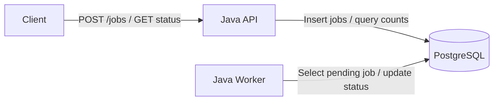
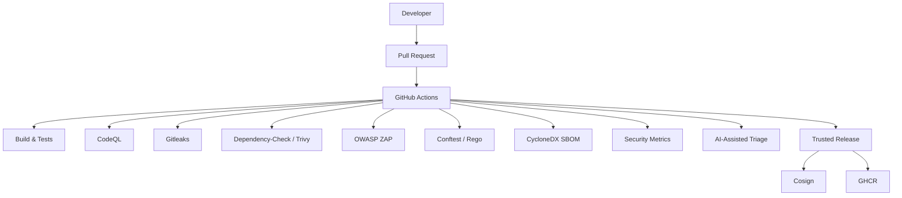
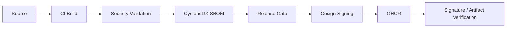

# Architecture — AI-Assisted DevSecOps Security Pipeline

## Purpose and Scope

This document describes the current application, security, CI/CD, software supply-chain, AI-assisted triage, and security-metrics architecture of the AI-Assisted DevSecOps Security Pipeline.

The project consists of:

- a Java API
- a background Java worker
- PostgreSQL
- Docker and Docker Compose
- GitHub Actions CI/CD
- SAST, SCA, secret scanning, container scanning, and DAST
- policy-as-code
- SBOM generation
- container signing and verification
- AI-assisted security triage
- security metrics and reliability validation

The architecture is educational and portfolio-oriented. It demonstrates defense-in-depth DevSecOps controls but is not presented as a complete production platform.

---

## Application Architecture

### Components

| Component | Implementation | Responsibility |
| --- | --- | --- |
| Java API | `src/main/java/com/nokishohid/devsecops/api/ApiMain.java` | Accept jobs and return status information |
| Java Worker | `src/main/java/com/nokishohid/devsecops/worker/WorkerMain.java` | Select pending jobs and update their state |
| Database Helper | `src/main/java/com/nokishohid/devsecops/Database.java` | JDBC connectivity and schema support |
| PostgreSQL | `postgres:16-alpine` | Persist jobs and processing state |
| Docker Compose | `docker-compose.yml` | Coordinate local API, worker, and database services |
| API Container | `Dockerfile.api` | Package the Java API |
| Worker Container | `Dockerfile.worker` | Package the Java worker |

---

## Job Lifecycle

1. A client submits a request to `POST /jobs`.
2. The Java API stores the submitted job data in PostgreSQL.
3. The API returns the job identifier and pending state.
4. The worker selects a pending job within a database transaction.
5. The worker updates the job state and processing timestamps.
6. The worker commits the database transaction.
7. The API provides aggregate status information to clients.

The worker uses `FOR UPDATE SKIP LOCKED` to reduce transaction contention when selecting pending jobs.

---

## API Behavior

The API exposes a deliberately small application surface.

Representative behavior includes:

| Endpoint | Purpose |
| --- | --- |
| `POST /jobs` | Submit a job |
| `GET /jobs` | Return aggregate job-state counts |
| `GET /health` | Return API health response |

The project has undergone API hardening and DAST validation, but the application remains educational rather than a complete production API gateway or identity platform.

Known production-oriented gaps are documented in the threat model and include comprehensive authentication, authorization, rate limiting, and WAF-style protection.

---

## Database Architecture

PostgreSQL stores job payloads, state, and processing metadata.

The API and worker both use the shared database helper for connectivity and schema support.

The database acts as the coordination layer between the API and worker. There is no separate message broker.

Primary database security concerns include:

- credential exposure
- unauthorized database access
- SQL injection
- transaction integrity
- job-state tampering
- production credential separation

---

## Local Runtime Architecture

The Docker Compose configuration coordinates three main services:

| Service | Runtime Role |
| --- | --- |
| API | Java HTTP service |
| Worker | Background job processor |
| PostgreSQL | Persistent database |

The API is mapped to localhost for local testing.

The worker and PostgreSQL are not exposed as public application endpoints.

Application services wait for PostgreSQL health before startup.

---

## CI/CD Architecture

GitHub Actions is the primary automation layer.

The repository contains independent security workflows so each security domain can be validated explicitly.

---

## Security Workflow Coverage

| Workflow | Security Function |
| --- | --- |
| `ci.yml` | Build and test |
| `codeql.yml` | Static application security testing |
| `codeql-regression.yml` | CodeQL regression validation |
| `gitleaks.yml` | Secret detection |
| `dependency-check.yml` | Dependency vulnerability analysis |
| `trivy.yml` | Filesystem/container vulnerability scanning |
| `zap.yml` | Dynamic application security testing |
| `zap-regression.yml` | ZAP regression validation |
| `sbom.yml` | CycloneDX SBOM generation |
| `policy.yml` | Policy-as-code validation |
| `container-release.yml` | Trusted container release |
| `ai-triage.yml` | Advisory AI-assisted finding triage |
| `security-metrics.yml` | Security metrics and reliability validation |

---

## GitHub Actions Hardening

GitHub Actions workflows use immutable SHA pinning for third-party actions.

The current repository verification confirms all detected action references are pinned using full commit SHAs.

Additional workflow hardening includes:

- explicit workflow permissions
- read-only permissions where possible
- protected branch requirements
- pull-request-based development
- security regression checks
- actionlint validation
- controlled workflow triggers

This reduces dependency on mutable action tags.

---

## Static Application Security Testing

CodeQL performs SAST against the application source.

The project also includes controlled regression validation so that security detection behavior can be verified rather than assumed.

CodeQL findings may feed the AI-assisted triage workflow after successful analysis.

---

## Secret Detection

Gitleaks scans source changes and repository content for exposed secrets.

Regression validation ensures secret-detection behavior remains operational.

Secrets required by CI/CD are expected to use repository or workflow secret mechanisms rather than source-code storage.

---

## Software Composition Analysis

Dependency-Check and Trivy provide vulnerability analysis across dependencies, filesystem content, and container-related assets.

The project distinguishes:

- dependency vulnerabilities
- operating-system package vulnerabilities
- fixability
- severity
- report availability

Security metrics consume selected SCA results to provide consolidated reporting.

---

## Dynamic Application Security Testing

OWASP ZAP evaluates runtime web-security behavior.

The project includes:

- baseline scanning
- policy-based interpretation
- regression validation
- historical scan evidence

DAST complements SAST by evaluating behavior only visible when the application is running.

---

## Container Security

Container security includes:

- hardened Dockerfiles
- vulnerability scanning
- runtime configuration validation
- reduced-privilege design where implemented
- controlled publishing
- image signing
- provenance-oriented release controls

Container controls are validated independently from application source-code controls.

---

## Policy as Code

Conftest and Rego policies provide automated configuration validation.

Policy controls are intended to detect insecure infrastructure or container configuration before release.

Policy-as-code provides repeatable enforcement instead of relying only on manual review.

---

## Software Supply Chain

Supply-chain controls include:

- CycloneDX SBOM generation
- container release gating
- GHCR publishing
- Cosign keyless signing
- signature verification
- trusted release evidence
- dependency and container scanning

These controls improve artifact traceability and tamper resistance.

---

## AI-Assisted Security Triage

The AI triage workflow is separate from the application runtime.

The Java API and worker do not directly call an AI model.

The workflow analyzes security findings after CodeQL execution.

Security controls include:

- external AI disabled by default
- explicit opt-in requirement
- API key requirement
- repository source-path restrictions
- Java source-context restrictions
- file-size restrictions
- finding-count limits
- malformed-response fallback
- advisory-only output

Malformed or untrusted AI output falls back to `needs_review`.

AI output does not automatically fix code, dismiss findings, or bypass required security checks.

---

## AI External Data Boundary

When external AI is explicitly enabled, selected finding information and restricted source context may leave GitHub Actions and be processed by the configured external AI provider.

This creates a distinct trust boundary.

Primary risks include:

- accidental disclosure
- excessive context sharing
- malformed AI output
- inaccurate classification
- overreliance on model recommendations

The workflow is therefore default-disabled and advisory.

---

## Security Metrics and Reliability

Phase 14 introduced automated security metrics collection.

The metrics architecture includes:

- Dependency-Check report ingestion
- Trivy report ingestion
- ZAP report ingestion
- deterministic metrics generation
- missing-report handling
- regression validation
- CI reliability measurement

The metrics collector does not treat unavailable historical security reports as fatal.

Instead, report availability is explicitly recorded.

This improves CI resilience while preserving visibility into missing evidence.

---

## Trust Boundaries

Important trust boundaries include:

| Boundary | Primary Risk |
| --- | --- |
| Client → API | Untrusted input and denial of service |
| API / Worker → PostgreSQL | Credential misuse and data tampering |
| Developer → GitHub | Account compromise and malicious commits |
| Repository → GitHub Actions | Workflow tampering and execution risk |
| CI → Security tools | Tool and dependency trust |
| CI → GHCR | Artifact publishing integrity |
| CI → Sigstore/Cosign | Signing identity and verification trust |
| Security reports → AI triage | Data disclosure and AI-output risk |

Detailed STRIDE analysis is maintained in `docs/threat-model.md`.

---

## Branch Protection and Change Control

The repository uses pull-request-based development and protected-branch controls for `main`.

Required checks provide merge gating for security-sensitive changes.

Git history, pull-request history, workflow logs, and evidence artifacts provide traceability.

Branch protection is considered a preventive control, while scanning and regression validation provide detective controls.

---

## Security Evidence Architecture

The project intentionally preserves security evidence across phases.

Evidence includes:

- screenshots
- scan reports
- regression-test output
- workflow logs
- SBOMs
- policy results
- security metrics
- pull-request validation

This evidence supports repeatability, portfolio review, and audit-style verification.

Evidence does not replace automated controls; it demonstrates that those controls were executed.

---

## Deployment and Runtime Limitations

The repository contains deployment-related artifacts, including Render and Kubernetes configuration.

Their presence does not by itself prove:

- continuous production deployment
- Kubernetes admission enforcement
- production identity management
- production-grade rate limiting
- production WAF protection
- production database RBAC
- end-to-end runtime monitoring

These limitations are intentionally retained as residual risks rather than presented as completed capabilities.

---

## Known Architectural Limitations

Current known limitations include:

- multiple-worker concurrency behavior is not fully validated as a production workload
- the project is not a complete production IAM implementation
- the API does not represent a full API-gateway architecture
- production WAF and comprehensive rate limiting are not implemented
- development credentials must not be reused in production
- external service availability remains outside repository control
- scanner false positives and false negatives remain possible
- AI classification accuracy requires independent evaluation
- deployment-time admission verification is not equivalent to release-time signing
- local and CI environments do not fully reproduce production infrastructure

---

## Security Architecture Summary

The project implements defense in depth across:

1. source-code security
2. secrets detection
3. dependency security
4. container security
5. runtime web testing
6. policy enforcement
7. software supply-chain integrity
8. workflow hardening
9. AI-assisted security analysis
10. security metrics and reliability

The architecture combines preventive, detective, and validation controls rather than relying on a single security tool.

---

## Related Documentation

- `docs/threat-model.md`
- `docs/METRICS.md`
- `docs/POLICIES.md`
- `docs/adr/README.md`
- `PROJECT-SCOPE.md`
- `README.md`