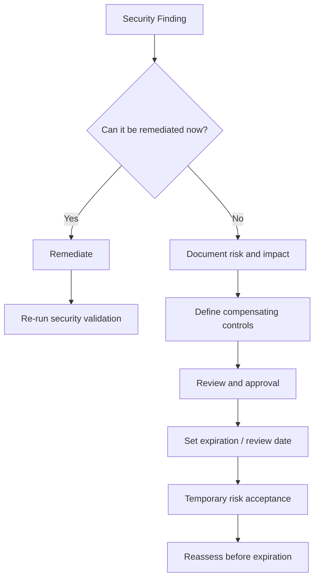

# Risk and Security Control Mapping

## Purpose

This document maps the primary security risks identified in the AI-Assisted DevSecOps Security Pipeline to the controls implemented throughout the project.

It complements:

- `docs/threat-model.md`

- `docs/architecture.md`

- `security/sca/RISK-ACCEPTANCE-POLICY.md`

- `security/sca/RISK-ACCEPTANCE-TEMPLATE.md`

The objective is to show how identified risks are prevented, detected, validated, monitored, or formally accepted.

---

## Risk Treatment Model

The project uses four primary risk-treatment approaches:

| Treatment | Meaning |

| --- | --- |

| Mitigate | Reduce likelihood or impact through technical or procedural controls |

| Detect | Identify security conditions through automated or manual monitoring |

| Validate | Confirm controls remain operational through tests and regression checks |

| Accept | Temporarily accept documented residual risk when remediation is not immediately feasible |

Risk acceptance is not considered a replacement for remediation.

Accepted risks must follow the project risk-acceptance policy, including documentation, compensating controls, approval, review, and expiration.

---

## Security Risk Categories

The project groups security risk into these major areas:

1\. source-code vulnerabilities

2\. secret exposure

3\. vulnerable dependencies

4\. container and runtime weaknesses

5\. web/API vulnerabilities

6\. CI/CD workflow compromise

7\. software supply-chain tampering

8\. infrastructure and policy misconfiguration

9\. AI-assisted triage misuse or data disclosure

10\. security-control drift

11\. unavailable or incomplete security evidence

12\. residual and temporarily accepted vulnerabilities

---

## Risk-to-Control Mapping

| Risk | Primary Controls | Treatment | Validation |

| --- | --- | --- | --- |

| Vulnerable application source code | CodeQL SAST | Mitigate / Detect | CodeQL workflow and regression tests |

| Hardcoded credentials or secrets | Gitleaks | Mitigate / Detect | Secret-scanning workflow and regression validation |

| Vulnerable third-party dependencies | OWASP Dependency-Check, Trivy | Detect / Mitigate | SCA workflows and severity/fixability gates |

| Unpatched container packages | Trivy | Detect / Mitigate | Container/filesystem scanning |

| Insecure Docker or infrastructure configuration | Conftest, Rego, hardened Dockerfiles | Mitigate / Validate | Policy workflow and policy tests |

| Runtime web vulnerabilities | OWASP ZAP | Detect / Validate | DAST and ZAP regression tests |

| Unauthorized changes to protected code | Pull requests, branch protection, required checks | Mitigate | GitHub merge controls |

| Mutable or compromised GitHub Actions dependencies | Immutable SHA pinning | Mitigate | Phase 12 action-reference validation |

| Excessive workflow permissions | Explicit workflow permissions | Mitigate | Workflow review and hardening validation |

| Software supply-chain tampering | CycloneDX SBOM, Cosign signing, verification | Mitigate / Detect | Trusted release validation |

| Unknown software components | CycloneDX SBOM | Detect | SBOM generation and review |

| Unauthorized container publishing | Controlled release workflow | Mitigate | Main-branch release gating |

| AI-assisted triage data disclosure | External AI disabled by default, explicit opt-in, restricted source context | Mitigate | AI-triage regression tests |

| Incorrect or malformed AI output | Advisory-only AI output, safe fallback to `needs\_review` | Mitigate / Validate | AI-triage validation tests |

| Security-control regression | Controlled vulnerable fixtures and regression tests | Detect / Validate | Security regression workflows |

| Missing historical security reports | Resilient metrics collector and availability tracking | Detect / Validate | Phase 14 metrics regression tests |

| Vulnerability cannot be immediately remediated | Risk-acceptance policy, expiration, compensating controls | Accept / Mitigate | Review and approval process |

---

## STRIDE Cross-Reference

The risk mapping aligns with the STRIDE threat categories documented in `docs/threat-model.md`.

| STRIDE Category | Representative Project Risk | Primary Controls |

| --- | --- | --- |

| Spoofing | Compromised developer identity or unauthorized client | Branch protection, repository controls, limited API surface |

| Tampering | Source, workflow, image, or job-state modification | Required checks, SHA pinning, Cosign, database transactions |

| Repudiation | Security-impacting change cannot be attributed | Git history, pull requests, workflow logs, evidence |

| Information Disclosure | Secret or sensitive-context exposure | Gitleaks, restricted AI context, environment-based secrets |

| Denial of Service | API or CI resource exhaustion | Runtime hardening, job controls, scoped workflows |

| Elevation of Privilege | Excessive CI/CD or application permissions | Least-privilege workflow permissions, service isolation |

---

## CIA Security Objectives

| Security Objective | Project Examples |

| --- | --- |

| Confidentiality | Secret scanning, restricted AI context, environment-based credentials |

| Integrity | Branch protection, required checks, SBOMs, Cosign signing, SHA pinning |

| Availability | CI reliability validation, resilient metrics handling, runtime health checks |

---

## OWASP-Oriented Mapping

The project does not claim formal OWASP certification or complete production coverage.

The implemented controls nevertheless address several common OWASP-style risk areas:

| Risk Area | Project Control |

| --- | --- |

| Injection | Input handling, CodeQL, DAST |

| Security Misconfiguration | Policy-as-code, container hardening |

| Vulnerable and Outdated Components | Dependency-Check, Trivy |

| Software and Data Integrity Failures | SBOMs, Cosign, trusted release workflow |

| Security Logging and Monitoring Failures | Workflow logs, security metrics, preserved evidence |

| Identification / Authentication Limitations | Documented as residual risk rather than overstated as complete |

---

## Software Supply-Chain Risk Mapping

| Supply-Chain Risk | Control |

| --- | --- |

| Unknown dependencies | CycloneDX SBOM |

| Vulnerable dependency versions | Dependency-Check / Trivy |

| Malicious workflow dependency | Immutable SHA pinning |

| Artifact modification | Cosign signing and verification |

| Unauthorized publishing | Controlled release workflow |

| Missing release traceability | Git history, workflow logs, SBOMs, signed artifacts |

---

## CI/CD Risk Mapping

| CI/CD Risk | Control |

| --- | --- |

| Direct unsafe change to `main` | Protected branch and pull requests |

| Security checks bypassed | Required checks |

| Third-party action tag changes | Full commit-SHA pinning |

| Excessive token permissions | Explicit least-privilege permissions |

| Secret leakage | Gitleaks and GitHub secret handling |

| Security workflow regression | Dedicated regression tests |

| Incomplete reporting | Security metrics and evidence preservation |

---

## AI-Assisted Triage Risk Mapping

| AI Risk | Control |

| --- | --- |

| Accidental external processing | External AI disabled by default |

| Excessive source disclosure | Restricted source-path and Java-only context |

| Oversized context | File-size and finding-count restrictions |

| Malformed AI response | Safe fallback to `needs\_review` |

| Incorrect recommendation | Advisory-only output |

| Automatic unsafe remediation | AI cannot automatically fix or dismiss findings |

AI-assisted triage is a decision-support mechanism, not an autonomous security authority.

---

## Risk Acceptance Process

Some vulnerabilities may not be immediately remediable.

The project therefore includes a documented SCA risk-acceptance process.

A valid risk-acceptance record requires:

- vulnerability identification

- severity and impact analysis

- remediation status

- justification

- compensating controls

- approval

- expiration date

- review requirement

Risk acceptance must be temporary and must not silently bypass the security gate.

---

## Risk Acceptance Decision Flow

---

## Residual Risk

Residual risk remains after controls are applied.

Examples include:

- zero-day vulnerabilities

- compromised trusted accounts

- scanner false negatives

- malicious insiders

- external-service compromise

- production infrastructure not represented by the lab

- incomplete production IAM

- lack of production WAF and comprehensive rate limiting

- AI classification error

- vulnerabilities accepted temporarily under documented exception procedures

Residual risk must be documented rather than hidden.

---

## Control Validation Strategy

Controls are validated through multiple mechanisms:

- unit tests

- integration tests

- controlled vulnerable fixtures

- regression tests

- SAST

- SCA

- secret scanning

- DAST

- policy-as-code tests

- SBOM review

- Cosign verification

- workflow validation

- AI-triage validation

- metrics regression testing

- pull-request required checks

This separates the existence of a control from evidence that the control actually operates.

---

## Risk Governance Principle

The project follows these principles:

1\. security controls should be automated where practical;

2\. security findings should be visible rather than suppressed silently;

3\. accepted risk must be documented and time-limited;

4\. preventive controls should be supported by detective controls;

5\. security gates should be regression-tested;

6\. residual risk should be stated explicitly;

7\. portfolio documentation must not claim production capabilities that were not validated.

---

## Summary

The AI-Assisted DevSecOps Security Pipeline uses layered risk treatment across source code, dependencies, containers, application runtime, CI/CD, software supply chain, AI-assisted triage, and security metrics.

The project combines preventive, detective, validation, and formal risk-acceptance controls.

This mapping demonstrates how individual security tools contribute to a broader risk-management strategy rather than functioning as isolated scanners.
